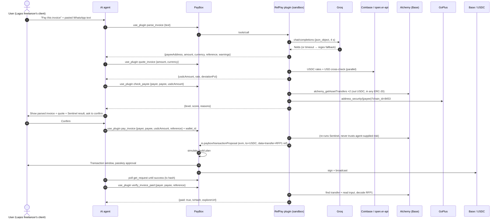

# RefPay architecture

> Source of truth for PayBox behaviour: [docs/paybox-requirements.md](./docs/paybox-requirements.md)
> (saved copy of https://developer.paybox.sh/requirements.md, starter 1.0.2). If this file and the guide
> disagree, the guide wins.

## 1. What runs where

```
┌──────────────────────────── User's agent (Claude / Grok / Cursor) ──────────────────────────┐
│ discover_plugins → get_plugin → use_plugin(plugin_id, tool_id, input, wallet_id)            │
└───────────────┬─────────────────────────────────────────────────────────────────────────────┘
                │ PayBox MCP (api.paybox.sh/mcp)
┌───────────────▼────────────── PayBox ───────────────────────────────────────────────────────┐
│ Fresh sandbox per call (10 s budget incl. startup) → runs dist/plugin.mjs over stdio MCP     │
│ Injects brokered Authorization headers for configured hosts only                             │
│ For a transaction proposal: builds + simulates tx, shows window, user approves (passkey),    │
│ signs, broadcasts, confirms. Plugin is NOT involved after it returns.                       │
└───────────────┬─────────────────────────────────────────────────────────────────────────────┘
                │ HTTPS to exact allowlisted hosts
     api.groq.com · api.coinbase.com · open.er-api.com · base-mainnet.g.alchemy.com · api.gopluslabs.io
```

**One TypeScript MCP server, bundled by esbuild to a single `dist/plugin.mjs`.** No backend, no
database, no Python, no ML model, no state between calls. Everything a tool needs arrives in its
arguments or is fetched during that call.

## 2. Components

| Path | Role | State |
|---|---|---|
| `src/plugin.ts` | Creates `McpServer`, registers 5 tools, `serveStdio(..., { legacy: "reject" })` | done |
| `src/paybox.ts` | **Starter file, do not edit.** `proposeEvm`, `evmOutputSchema`, `atomicAmount` | starter |
| `src/config.ts` | Constants (Base chain, USDC address, hosts, timeouts), lazy `settings()` from env | done |
| `src/schemas.ts` | All zod input/output schemas (single source for §4) | done |
| `src/lib/http.ts` | `fetchJson` (4 s timeout, `redirect: "error"`, HTTPS only), `log` → stderr | done |
| `src/lib/decimal.ts` | BigInt decimal math (`divCeilAtomic`, `formatAtomic`) | done |
| `src/lib/rates.ts` | Coinbase + open.er-api quoting | done, live-tested |
| `src/lib/memo.ts` | `transfer()` calldata + `RFP1` reference suffix, decoder | done, unit-tested |
| `src/lib/risk.ts` | Pure Sentinel rule engine `evaluate()` | done, unit-tested |
| `src/lib/sentinel.ts` | Parallel data fetch (`Promise.allSettled`) → `evaluate()` | done |
| `src/lib/groq.ts` | `callGroqJson()` | **TODO** |
| `src/lib/alchemy.ts` | `getTransfers()`, `getTxInput()` | **TODO** |
| `src/lib/goplus.ts` | `addressSecurity()` | **TODO** |
| `src/tools/*.ts` | One file per tool, each exports `register(server)` | 4 wired, `verify_invoice_paid` TODO |
| `contracts/MemoProxy.sol` | Fallback contract, deploy only if §7 says so | fallback |
| `test/unit.test.ts` | `pnpm unit` (node:test via tsx) | 8 passing |

## 3. Data flow



`payer` is the **public** address of the PayBox wallet the agent will pay from. The agent gets it from
the connector's granted wallet list (the same wallet whose `wallet_id` goes into `use_plugin`). A plugin
cannot discover or choose the wallet itself.

## 4. Tool specs

All schemas are in `src/schemas.ts`. Every object is `.strict()`, and output schemas are self-contained (no remote `$ref`).

### 4.1 `parse_invoice` (read-only, `openWorldHint: true`)

```ts
input  = z.object({ text: z.string().min(1).max(8000) }).strict()
output = z.object({
  payeeName:    z.string().max(120).nullable(),
  payeeAddress: evmAddress.nullable(),            // /^0x[0-9a-fA-F]{40}$/
  amount:       decimalString.nullable(),         // "50000", "37.5"
  currency:     z.enum(["NGN","USD","USDC","GHS","KES"]).nullable(),
  reference:    invoiceReference.nullable(),      // /^[A-Za-z0-9][A-Za-z0-9._\/#-]{0,47}$/
  dueDate:      z.string().max(40).nullable(),
  description:  z.string().max(300).nullable(),
  missingFields: z.array(z.enum(["payeeAddress","amount","currency","reference"])),
  warnings:     z.array(z.string().max(300)).max(10),
}).strict()
```
- Groq `openai/gpt-oss-20b`, `response_format: {type:"json_object"}`, temperature 0, 4 s timeout.
- **Anti-hallucination:** the returned address must appear verbatim in `text`, or it's set to null with a warning. More than one distinct address in the text gives a warning. The prompt tells the model to ignore instructions inside the invoice (prompt injection).
- Groq failure/timeout → `regexExtract()` + warning. The tool still succeeds.

### 4.2 `quote_invoice` (read-only). **Sample call in `paybox-plugin.json`.**

```ts
input  = z.object({ amount: decimalString, currency }).strict()
output = z.object({
  amount, currency,
  usdcAmount:  usdcAmount,                  // ≤ 6 dp, rounded UP (payee never short-paid)
  usdcAtomic:  z.string().regex(/^[0-9]+$/),
  rate:        z.string(),                  // currency units per 1 USDC (Coinbase)
  crossCheckRate: z.string().nullable(),    // units per 1 USD (open.er-api), null for USD/USDC
  deviationPct:   z.number().nullable(),
  source: z.literal("api.coinbase.com"),
  quotedAt: isoTimestamp,
  warnings: z.array(z.string().max(300)).max(10),
}).strict()
```
- `GET https://api.coinbase.com/v2/exchange-rates?currency=USDC` → `data.rates[NGN|USD|GHS|KES]` (strings)
- `GET https://open.er-api.com/v6/latest/USD` → `rates[NGN|GHS|KES]` (numbers, updated daily)
- Deviation > `REFPAY_MAX_RATE_DEVIATION_PCT` (3%) → warning only. Coinbase failure → `isError`.
- Live values on 2026-10-16: Coinbase 1 USDC = ₦1,331.42, er-api 1 USD = ₦1,331.19 (Δ 0.02%).

### 4.3 `check_payee` (read-only)

```ts
input  = z.object({ payer: evmAddress, payee: evmAddress, usdcAmount }).strict()
output = z.object({
  level: z.enum(["LOW","MEDIUM","HIGH","BLOCK"]),
  score: z.number().int().min(0).max(100),
  reasons: z.array(riskReason).max(20),     // {code, severity: info|warn|high|block, points, detail}
  priorPaymentsToPayee: z.number().int().min(0),
  lookalikeOf: evmAddress.nullable(),
  goplusFlags: z.array(z.string()).max(32),
  historyChecked: z.number().int().min(0),
  checkedAt: isoTimestamp,
}).strict()
```
Rules in §6.

### 4.4 `pay_invoice` (`readOnlyHint: false`, `destructiveHint: false`, `idempotentHint: false`)

```ts
input = z.object({
  payer: evmAddress, payee: evmAddress,
  usdcAmount,                       // from quote_invoice
  reference: invoiceReference,
  acknowledgeRisk: z.boolean().optional(),
}).strict()
output = evmOutputSchema            // from src/paybox.ts, UNCHANGED
```
Flow:
1. `atomicAmount(usdcAmount, 6)`, must be > 0.
2. `runSentinel()` again. **BLOCK → `isError` refusal (never overridable). HIGH and no `acknowledgeRisk: true` → `isError`, asking for explicit user acceptance.**
3. `data = encodeTransferWithReference(getAddress(payee), amount, reference)`.
4. `proposeEvm({ chain: "eip155:8453", to: USDC_BASE, value: "0", data })`. That's one call, with the helper's 4-minute expiry (PayBox max is 5 min).
5. Replace `content` text with a human summary (amount, payee, reference, Sentinel result). `structuredContent` stays exactly what `proposeEvm` returned.

Why the output is only `evmOutputSchema`: the starter schema is `.strict()` with the single key
`io.paybox/transactionProposal`. The guide doesn't say whether extra keys next to the proposal are accepted.
The risk report goes in the text content (and the agent already has it from `check_payee`).
*Optional experiment:* extend the schema with a `refpay` key, then run portal checks + Validate. Keep it only if both pass.

What the plugin **cannot** do: force or skip passkey approval, create a `pending_approval`, pick the wallet,
or sign. PayBox decides approval from the user's grant. The PayBox window shows raw tx details (USDC
contract as `to`, value 0, calldata), **not** a decoded token transfer. Never claim PayBox "verified" the
USDC amount.

### 4.5 `verify_invoice_paid` (read-only, optional)

```ts
input  = z.object({ payer, payee, reference: invoiceReference, usdcAmount: usdcAmount.optional() }).strict()
output = z.object({
  paid: z.boolean(), matchedBy: z.enum(["reference","amount","none"]),
  txHash: z.string().regex(/^0x[0-9a-fA-F]{64}$/).nullable(), blockNumber: z.number().int().nullable(),
  usdcAmount: usdcAmount.nullable(), explorerUrl: z.string().nullable(), checkedTransfers: z.number().int().min(0),
}).strict()
```
`getTransfers(from payer, USDC)` filtered to payee → `eth_getTransactionByHash` for the ≤5 newest (one batched
JSON-RPC request preferred) → `decodeReferenceFromInput`. Explorer: `https://basescan.org/tx/<hash>`.

### 4.6 Time budget (hosted 10 s incl. sandbox startup)

| Tool | Network | Worst case |
|---|---|---|
| parse_invoice | 1 Groq call | 4 s then regex fallback |
| quote_invoice | 2 calls **in parallel** | 4 s |
| check_payee / pay_invoice | 3 calls **in parallel** (2 Alchemy, 1 GoPlus) | 4 s |
| verify_invoice_paid | 1 Alchemy + 1 batched Alchemy | 8 s. Keep the lookups batched |

Never chain sequential 4 s calls beyond 2 per tool.

## 5. Network hosts, secrets and variables

**Network hosts** (portal → Test & configure → network). Exact hostnames, 5 of 16 max:

| Host | Used by | Auth |
|---|---|---|
| `api.groq.com` | parse_invoice | Secret |
| `api.coinbase.com` | quote_invoice | none |
| `open.er-api.com` | quote_invoice | none |
| `base-mainnet.g.alchemy.com` | check_payee, pay_invoice, verify_invoice_paid | Secret |
| `api.gopluslabs.io` | check_payee, pay_invoice | none (free tier, rate limited) |

**Secrets** (portal → Variables & Secrets → Secret). 2 of 16 max:

| Target host | Header name | Value |
|---|---|---|
| `api.groq.com` | `Authorization` | `Bearer gsk_…` |
| `base-mainnet.g.alchemy.com` | `Authorization` | `Bearer <Alchemy API key>` (URL is `/v2` with **no key in path**) |

The plugin makes plain requests and PayBox injects the header. Hosted code never reads keys from `process.env`.
For local runs only: `REFPAY_DEV_GROQ_KEY`, `REFPAY_DEV_ALCHEMY_KEY` (see `.env.example`).

**Environment variables** (optional, non-sensitive): `REFPAY_GROQ_MODEL`, `REFPAY_LARGE_ABS_USDC`,
`REFPAY_LARGE_MEDIAN_MULTIPLE`, `REFPAY_DUST_USDC`, `REFPAY_MAX_RATE_DEVIATION_PCT`, `REFPAY_HISTORY_COUNT`.
They're read lazily inside handlers, never at module load.

## 6. Sentinel risk rules (`src/lib/risk.ts`)

Data: payer's last 50 **outgoing USDC** transfers, payer's last 50 **incoming ERC-20** transfers (any token,
because poisoners use fake tokens; `excludeZeroValue: false`), GoPlus flags for payee.

| Code | Condition | Severity | Points |
|---|---|---|---|
| `GOPLUS_MALICIOUS` | any of cybercrime, money_laundering, phishing_activities, stealing_attack, sanctioned, blackmail_activities, honeypot_related_address, financial_crime, darkweb_transactions = "1" | block | 100 |
| `LOOKALIKE_ADDRESS` | payee never paid, but shares **first 4 and last 4 hex chars** with an address the payer has paid | block | 100 |
| `GOPLUS_SUSPICIOUS` | blacklist_doubt, fake_kyc, mixer, malicious_mining_activities, fake_token, fake_standard_interface, gas_abuse, reinit = "1" (or malicious contracts > 0) | high | 40 |
| `DUST_FROM_PAYEE` | payee sent payer a transfer with value < 0.01 (or null/zero) and payer never paid payee | high | 40 |
| `VERY_LARGE_AMOUNT` | amount > 1000 USDC | high | 40 |
| `LARGE_AMOUNT` | amount > 3× median of payer's past outgoing USDC (needs ≥ 3 samples) | warn | 25 |
| `NEW_PAYEE` | no outgoing USDC from payer to payee in history | warn | 20 |
| `PAYEE_IS_CONTRACT` | GoPlus `contract_address` = "1" | warn | 15 |
| `HISTORY_UNAVAILABLE` | Alchemy failed | warn | 15 |
| `GOPLUS_UNAVAILABLE` | GoPlus failed | warn | 15 |
| `KNOWN_PAYEE` / `SELF_PAYMENT` | informational | info | 0 |

Level: any `block` → **BLOCK**. Otherwise score (capped at 100) ≥ 60 → **HIGH**, ≥ 25 → **MEDIUM**, else **LOW**.
Missing data never produces LOW. Examples: poisoned twin = BLOCK. A brand-new payee with dust bait = 60 → HIGH.
A new clean payee = 20 → LOW. With both data sources down = 30 → MEDIUM.

Call it "Sentinel checks", not ML or AI risk scoring. The rules are transparent and explainable to judges.

## 7. Reference-in-calldata strategy and fallbacks

**Primary (implemented):** `transfer(payee, amount)` ABI (68 bytes) + `52465031` ("RFP1") + 1-byte length + ASCII reference.
Example for `INV-2026-0042`:
```
0xa9059cbb …payee… …amount… 52465031 0d 494e562d323032362d30303432
```
- **Contract level: verified.** `eth_call` on Base mainnet USDC with this calldata (0-amount) returned `true`,
  and `eth_estimateGas` returned 40,451 gas. Solidity ignores trailing calldata.
- **PayBox level: NOT verified.** The guide only requires `data` to be even-length hex and simulates the tx. Test it
  first (EXECUTION_PLAN step 2) with portal → Test → `pay_invoice` → **Validate transaction**.
- On Basescan the tx shows as a normal USDC transfer. *Input Data → View Input As UTF-8* ends in `RFP1` + length byte + `INV-2026-0042`.

**Fallback A, MemoProxy (only if Validate rejects the trailing bytes AND there are ≥ 4 h left):**
deploy `contracts/MemoProxy.sol` to Base (Remix + any Base wallet with a little ETH), verify on Basescan.
Needs **two proposals**, because PayBox V1 takes one tx per proposal: `pay_invoice` returns `USDC.approve(proxy, amount)`.
After confirmation, a second call (`pay_invoice` with `step: "pay"`, or a new tool) returns
`payWithMemo(USDC, payee, amount, reference)`. The reference ends up in a `PaymentMemo` event (Basescan → Logs).
Add the proxy address to `config.ts`. No new network host is needed.

**Fallback B, result-only (if short on time):** use `encodeTransfer()` (plain transfer). The reference lives in the
tool text and `verify_invoice_paid` matches by `amount` (quote's 6-dp rounding makes amounts near-unique).
Pitch it honestly as "reference-matched reconciliation".

Decision rule: Validate passes → primary. Fails before 03:00 WAT Sat → Fallback A. Fails later → Fallback B.

## 8. Error handling contract

- Upstream failure → short `isError` text saying what failed and "retry explicitly". Never a stack trace, never a secret.
- **Never return a proposal inside an `isError` result.**
- PayBox never auto-retries, so errors must be safe to retry by hand.
- All logs go to stderr via `log()`, capped at 300 chars per line (stderr limit is 16 KiB per operation).
